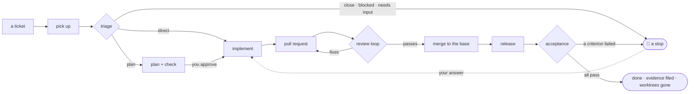

# Ticket pipeline — from a ticket to accepted work, with the record to prove it

Skills for coding agents that take a ticket through pickup, triage, planning,
implementation, pull request, review and merge, release and acceptance — every skill in
its own agent, every fact on disk, the project's specifics read from the project rather
than written into the skills. Enable the plugin in a project and pick, in one
interview, which of its twenty-one skills the project uses.
**[`flowcharts.md`](flowcharts.md)** draws every path this takes — the stages and their
decisions, stops and how they are answered, a day, a gate, the install — each branch
mapped to the file that decides it.

**Contents** — [The problem it solves](#the-problem-it-solves) · [The skills](#the-skills) · [How it works](#how-it-works) · [Where everything is](#where-everything-is)

## The problem it solves

Working a ticket end to end in one conversation fails in predictable ways:

- **Context rot.** The chat fills with diffs, install logs and gate output until the
  model's judgment degrades — and the record of what was decided lives only in that
  chat. Here every skill runs in a fresh agent that holds nothing but its arguments
  and the few rules it needs, reads rules by reference and command output by excerpt,
  and leaves its facts on disk in the ticket's work directory.
- **One mind checking itself.** The same context plans, implements and reviews, so a
  plausible-but-wrong change sails through. Here the checker never inherits the
  planner's reasoning, the implementer never the planner's, the reviewer never the
  author's — the review agent knows the PR and its ticket link, nothing else.
- **"Done" as a claim.** Nobody proves the acceptance criteria against the environment
  the change reached. Here a gate, a test, a request or a criterion walked against the
  released environment is what "delivered" means, and the evidence is filed.
- **Nothing to resume from.** A question, a failed gate or a closed laptop loses the
  work; a second ticket collides on the same checkout; nobody can see where each
  ticket stands. Here every stop is a logged question with its resume command, every
  ticket has its own worktree and lock, and a status board, an inbox and a virtual
  office show the state without re-reading logs.
- **Process baked into prompts.** Branch names, tracker fields and deploy pipelines end
  up in the instructions, so the process cannot move to the next project. Here the
  project's specifics come from its conventions file and the person's standing
  instructions; the skills carry none.
- **Cost nobody sees.** Agents re-read the same rules, re-run the same gates and
  re-create the same checkouts, and every agent costs a fixed overhead before it reads
  a thing, so what a run really costs is how many of them it started. Here
  gates run once per commit against a cached baseline, one worktree serves the whole
  run, rules are read by reference and command output by excerpt, a stage takes one
  agent for the whole ticket rather than one per repo, a list is filtered by command
  before an agent reads any of it, independent commands go in one call, tokens are
  recorded per stage and priced, and the day's plan runs independent tickets in
  parallel within the usage budget (§ Context management, rules 9 to 12).

## The skills

Twenty-one skills, in five groups. `/tp:setup` asks which groups and skills a project
wants and records the answer in `pipeline.json`; a skill that is off is not run (the
plugin is shared by every project that enables it, so nothing is uninstalled), and
everything that depends on it adapts — a run ends at the last active stage, a merge
without `/tp:review` stops for a person's review, a review without
`/tp:create-ticket` lists a pre-existing defect as *ticket needed*.

**Every skill lives in the `tp` plugin's namespace**, and that is the point: the words
these skills would otherwise want — `status`, `plan`, `review`, `merge`, `doctor`,
`setup`, `schedule` — are words a runtime command, another plugin or a person's own
skill already uses, and a collision does not announce itself: the wrong skill simply
runs. The folder and the `name:` in the frontmatter are the bare word
(`skills/verify/SKILL.md`, `name: verify`); the plugin's name in front makes the command
`/tp:verify` and the name the Skill tool loads it by, so every reference to a skill — in
a skill, in the runner, in a script that prints a command for a person to type — uses the
full `tp:` form. Stage names on disk do **not**: a stage is a row in the ticket's record
(`implement`, `merge`), not something anyone invokes. `NS` in `lib/setup.mjs` is the one
declaration; `tests/skills.test.mjs` fails on any invocation that loses it.

| Skill | Group | What it does |
|---|---|---|
| `/tp:setup` | — | The integration interview: which skills to activate, the largest model the pipeline may use, the project's gates in its git hooks, the allowlist, the preflight. Always installed. |
| `/tp:run-ticket <ids…>` | ticket pipeline | Runs tickets end to end — one orchestrator agent per ticket, each stage in its own agent — with a run lock, one notification per stop and state on disk so any run resumes; `next count=<n>` picks independent tickets itself. |
| `/tp:start-ticket <id>` | ticket pipeline | Picks a ticket up: blocked check, assign, in progress, rating and estimate, one worktree and branch per repo, the ticket's work directory. |
| `/tp:triage <id>` | ticket pipeline | Decides from the code whether the ticket is implemented directly, planned first, needs input, is closed or is blocked — with the evidence. |
| `/tp:plan <id>` | ticket pipeline | Writes a self-contained plan, has a fresh checker verify it in a bounded loop, and presents it for the person's approval. |
| `/tp:implement <id>` | ticket pipeline | Implements the approved plan in a fresh agent: a commit per step, checkpoints, gates at the end, deviations reported, the PR description drafted. |
| `/tp:create-pr <id>` | ticket pipeline | Commits, syncs, gates and validates the branch, pushes, opens or updates the PR and comments on it and the ticket. |
| `/tp:verify` | ticket pipeline | Runs the project's own gates — the ones its git hooks don't already enforce — as background processes against a cached baseline; a result is recorded per commit and reused. |
| `/tp:review <PR>` | review and merge | Reviews a PR in an isolated agent given only the PR and a neutral scope; incremental passes; posts the review with a machine-readable trailer. |
| `/tp:merge <id>` | review and merge | Runs the review loop to convergence with fix rounds, then merges into the base branch when the review passes and the person's instruction allows. |
| `/tp:release <id>` | after the merge | Watches what the merge triggered, runs the documented operator follow-ups, smoke-checks where it runs, promotes only when asked. |
| `/tp:accept <id>` | after the merge | Walks every acceptance criterion against the released environment or the merged revision, with evidence; the run's last stage. |
| `/tp:retro <id>` | after the merge | Compares the plan with what happened and proposes edits to the conventions file, the ticket template or the instructions. Proposals only. |
| `/tp:plan-day` | the day | Selects the day's tickets (sprint or seeded pool draw), checks blockers and dependencies, proposes the plan for review, then runs every independent ticket in parallel. |
| `/tp:inbox` | the day | Every open stop in one pass — its kind, age, the document to read and the resume command; re-invokes what resumes by itself, re-checks blockers, hands the rest over as one interview. |
| `/tp:eod` | the day | The day's close: what finished and what waits, estimates against minutes and actual hours, tokens and cost, carry-over, estimate drift. |
| `/tp:schedule` | the day | The unattended weekday loop through the runtime's scheduler: a probe, then morning, advance and end-of-day tasks. |
| `/tp:status` | tooling | Where every ticket stands — stage, waits, lock, PR and verdict, time, tokens and cost, worktrees, problems — computed by the state script. |
| `/tp:doctor` | tooling | The preflight: node, git, remotes, the hosting CLI, the tracker, the config files, the allowlist, the work directory — each failing check with its fix. |
| `/tp:notify` | tooling | One line per stop or finished run to the project's chat channel; silent without a chat tool. |
| `/tp:create-ticket` | tooling | Turns a request, a bug report or a review's pre-existing defects into well-formed tracker tickets. The only skill that creates tickets. |

The groups are the interview's questions: the *ticket pipeline* is the core every
other group builds on (`/tp:run-ticket` needs its six stage skills; `/tp:implement`,
`/tp:create-pr` and `/tp:review` need `/tp:verify`); *review and merge* comes off when people
review and merge by hand; *after the merge* when nothing deploys or a person checks;
*the day* is the loop around the pipeline (`/tp:schedule` needs the other three and is
off unless asked for); *tooling* stands alone. A dependency left out is added by the
script, and the report says for whom.

Two skills are started by a person and nobody else: `/tp:setup` interviews, and
`/tp:schedule` creates scheduled tasks. Both are marked `disable-model-invocation`, so no
agent has their description in its context, no subagent or scheduled prompt can run
them, and nothing unattended can change the project's configuration or the schedule.

## How it works

Every diamond is a decision made from evidence, every bell a question that waits for a
person — [`flowcharts.md`](flowcharts.md) draws all of them, including the paths this
summary leaves out (resume, the day, gates, the install). Stage by stage — who runs it,
in what agent, and what it leaves on disk (§ The skills has the one-line version of
each):

| Stage | Skill | Runs in | Writes |
|---|---|---|---|
| 0 | `/tp:create-ticket <text>` | its agent, read-only on the repo for the brief | a ticket in the tracker — no work directory, nothing logged |
| 1 | `/tp:start-ticket <id>` | its agent (the blockers' states read directly from the tracker) | worktree + branch per repo — kept for the whole run (§ Worktrees); `ticket.md/.json`, `progress.md` |
| 2 | `/tp:triage <id> [mode=direct\|plan]` | its agent, read-only on the repo, writing its two files | `triage.md/.json` — direct / plan / needs-input / close / blocked |
| 3 | `/tp:plan <id> [check-only=true]` (when triage says so) | its agent plans and revises; `plan-lint.mjs` checks the template, counts, files and citations without a model; a fresh checker per pass judges the rest — each read-only on the repo, writing its own file; the checked plan is presented to the person for approval | `plan.md/.json`, `plan-check.json`; the go-ahead in `answers.md` |
| 4 | `/tp:implement <id>` | its agent implements — one per repo, never the planner's | commits; `plan.md` summary; `implement[.repo].json`; the PR description drafted (`pr-body[.repo].md`) |
| 5 | `/tp:create-pr <id> [update=true]` (one run, every repo) | its agent (+ a diff validator on a creation round; a describer only for a branch `/tp:implement` left no draft for; `/tp:verify` only when no result is recorded for the commit) | a described, gated PR; comments, ticket status; `pr[.repo].json`, `report.md` |
| 6 | `/tp:merge <id>` (one run, every repo) | its agent (+ `/tp:review` per pass, a fixer and a `/tp:create-pr` round per fix round) | the review loop, the merge; `pr[.repo].json` reviews and sha — the worktree stays |
| 7 | `/tp:release <id> [promote=]` (one run, every repo) | its agent watches the runs and smoke-checks itself; an operator per tool set of follow-ups | deploy watched, follow-ups, smoke; `release[.repo].json` |
| 8 | `/tp:accept <id>` | its agent walks the criteria — the live environment, or the ticket's worktree at the merge commit; removes the worktrees at `done` | `accept.md/.json` — pass / fail / manual per criterion |
| 8b | `/tp:retro <id>` (optional) | its agent, read-only on the record, writing its two files | `retro.md/.json` — proposals only |
| — | `/tp:verify [path=] [base=] [tests=true] [full=true]` | its agent; the gates the repo's hooks don't own, as background processes, the base from one cached baseline per repo; a result recorded per commit pair and reused | gate table (`HOOK` rows for what the hooks enforce) |
| — | `/tp:review <PR> [mode=full\|delta\|resolution] [tier=] [checkout=]` | its agent, given only the PR, its ticket link and a checkout at the PR's head; the gates from the commit's recorded result, `/tp:verify` only when there is none; a pass's pre-existing defects in one `/tp:create-ticket` call | review comment, verdict, trailer |
| — | `/tp:status [<id> \| problems]` | its agent | a table |
| — | `/tp:notify "<text>" level=` · `/tp:notify setup` | the invoking context — one tool call, no agent | one message to the project's channel, or nothing |
| — | `/tp:run-ticket <ids…>` | one orchestrator agent per ticket, running 1–8 (+8b) | one line per stage; `report.md`; `lock.json` |
| — | `/tp:plan-day [<features…>] [count=] [dry=true] [approve=true]` | its agent (+ parallel lookups); the session interviews the person on the proposal, then starts the runs | the day's tickets, ordered by dependency, proposed for review, then fed to `/tp:run-ticket` in parallel; `_day/<date>.json/.md`, the approval stop |
| — | `/tp:inbox [<id>] [dry=true]` | its agent (the blockers' states read directly); the session interviews and re-invokes | every open stop with its kind and resume command; queued answers, usage pauses past reset and unblocked tickets re-invoked; the rest one interview |
| — | `/tp:eod [date=]` | its agent; the session asks the actual hours once | `_day/<date>.eod.json/.md` — the day's close; `ticket.json.actual` per finished ticket; one line to the channel |
| — | `/tp:doctor [repos=] [tests=true] [session=<model>]` | its agent (one tracker read) | `_doctor.json` — the preflight: toolchain, remotes, the platform CLI, the tracker, the files, the allowlist, the work directory — each with its fix |
| — | `/tp:schedule on\|off\|status` | its agent | the runtime's scheduled tasks: a probe, then the morning, advance and end-of-day tasks; `_schedule/tasks.json`, `probe.json` |
| — | `/tp:setup [all=true \| skills=a,b \| ceiling=<model> \| models=… \| status \| migrate]` | the invoking context — it asks the person | `pipeline.json` (which skills are on), `tiers.json` (the ceiling, the ladder, the three tiers); the allowlist lines printed |

Five ideas carry all of it:

- **Every skill runs in a dedicated agent** (§ Definitions). Whoever invokes it — a
  person, `/tp:run-ticket`, another skill — holds nothing but the report. A question for
  the person comes back as a stop, never as a dialogue inside an agent.
- **The work directory is the state** (§ Work directory): `.md` for people, `.json`
  contracts for the next stage, an append-only `progress.md`, and a dependency-free
  script that computes where a ticket stands and what runs next. Nothing is decided by
  re-reading a chat, so any run resumes and several run side by side.
- **Independence where it matters**: the checker never inherits the planner's
  reasoning, the implementer never the planner's, the reviewer never the author's —
  the review agent knows the PR and the ticket link it carries, never the work
  directory.
- **The model follows the task, under a ceiling you set** (§ Models and budget): each
  agent is spawned on the tier its own task's complexity needs — never on the model the
  session happens to run on — within the account's usage limits and never above the
  largest model you allowed at install.
- **"Delivered" means a check proved it** — a gate, a test, a request, a criterion
  walked against the environment the release reached.

Project-specific facts — base branch, naming, merge strategy, who reviews, what a merge
triggers, follow-ups, environments — come from the repo's **conventions file** and the
person's standing instructions, never from a skill.

## Where everything is

The skills point here instead of restating these; [`flowcharts.md`](flowcharts.md) maps
each rule below to the branch it decides, if a picture is the faster way in.

| File | What it holds | Sections |
|---|---|---|
| [`using.md`](using.md) | Install, run, resume, schedule, simulate: how a person uses the pipeline. | Using it |
| [`definitions.md`](definitions.md) | The vocabulary every skill shares: entry points, resume, the output contract, the dedicated agent, depth, asking the user, tools and permissions. | Definitions |
| [`work-directory.md`](work-directory.md) | The state every stage shares: its files and contracts, the worktrees, and how runs do not collide. | Work directory, Worktrees, Concurrency |
| [`failures-and-stops.md`](failures-and-stops.md) | How a stage stops, notifies, auto-resolves a failure within a bound and hands up without losing work. | Stops and notifications, Failures and escalation |
| [`context-management.md`](context-management.md) | The rules that keep an agent inside its context and the run inside its budget of agents. | Context management |
| [`models-and-budget.md`](models-and-budget.md) | The ceiling, the tiers, ratings, usage bands, estimates and cost. | Models and budget |
| [`verification.md`](verification.md) | Gates, hooks, generated code and the checks every stage and agent holds to. | Verification rules |
| [`observability.md`](observability.md) | What is visible and where, and the same pipeline run as a script or on a schedule. | Observability, Unattended runs |
| [`procedures.md`](procedures.md) | Remote access failures, the toolchain, commits, tickets, review scope and rounds, personal data. | Shared procedures |
| [`flowcharts.md`](flowcharts.md) | The same pipeline as diagrams — for people, not agents. | the stage flow, the stops, the skills a run reaches |

`node <lib>/ref.mjs "<Section>[, <Item>…]"` reads a section or an item of any of these by name — a stage never reads a whole file (`context-management.md` rule 10); `ref.mjs list` prints every heading and its items.
